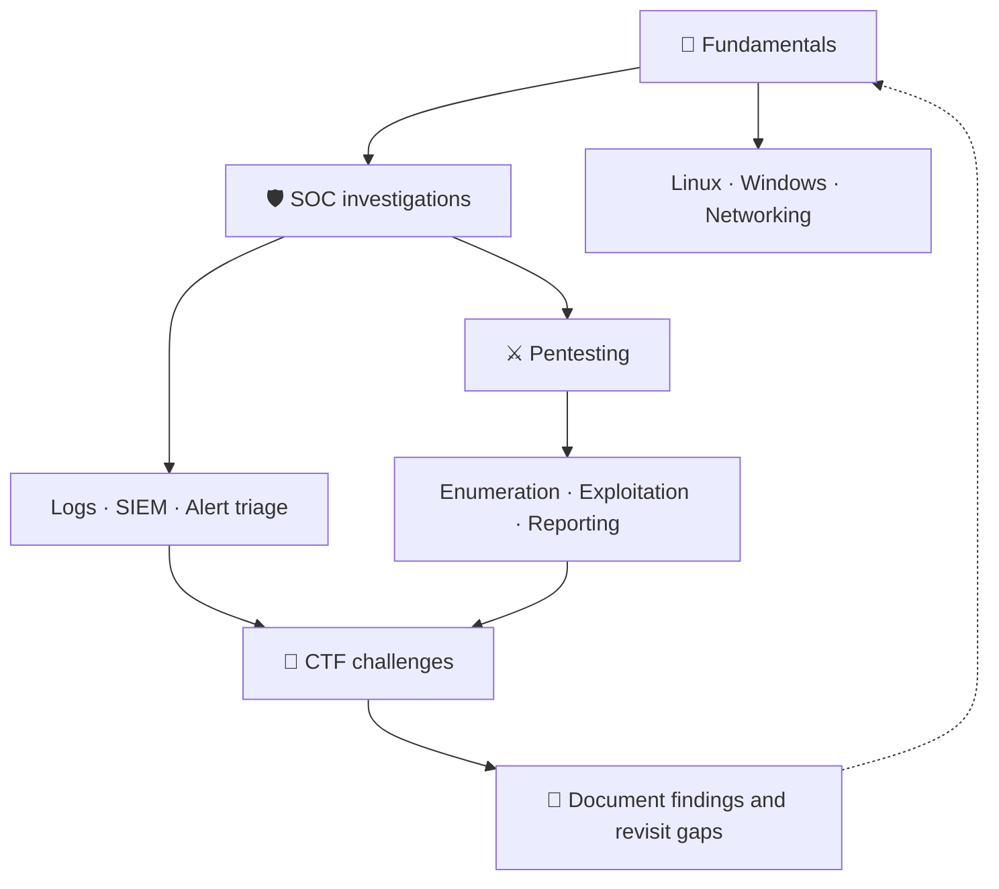

<div align="center">


<a href="https://tryhackme.com/p/YOUR_USERNAME">
  
</a>

<br />


<br /><br />

<a href="https://tryhackme.com/p/YOUR_USERNAME">🎯 TryHackMe profile</a>
&nbsp; • &nbsp;
<a href="#-progress-dashboard">📊 Progress</a>
&nbsp; • &nbsp;
<a href="#-room-log">📁 Room log</a>
&nbsp; • &nbsp;
<a href="#-connect">🤝 Connect</a>

</div>

---

## 👾 The mission

I'm Romansh, and this is my record of learning cybersecurity through TryHackMe.
My focus is SOC work on the blue team side and pentesting on the red team side.
I'm keeping track of the commands I run, the evidence I find, and the mistakes I learn from.
Each write-up should help me explain **what I did, why I did it, and what the result means**.

> **Current mission:** build practical skills and leave useful notes for my future self.

## 🧭 Learning roadmap



## 📊 Progress dashboard

<div align="center">

### PLAYER STATS

| 🧠 Capability score | 🏅 Highest league | 🌍 Ranking | 🔥 Highest streak |
| :---: | :---: | :---: | :---: |
| **33** | **Silver** | **Top 25%** | **18 days** |

**13 rooms listed · 4 learning tracks**

</div>

*Profile stats are from my November 10, 2026 snapshot. These values are maintained manually.*

### Track progress

<!--
Replace each empty bar and "Pending" once completion is confirmed.
Each filled block represents approximately 10%.
Example: [██████░░░░] 60%
Empty bars below are placeholders, not confirmed zero progress.
-->

| Track | Completion bar | Completed / listed |
| :--- | :--- | :---: |
| 🧱 Fundamentals | `[░░░░░░░░░░]` Pending | — / 5 |
| 🛡️ SOC / blue team | `[░░░░░░░░░░]` Pending | — / 5 |
| ⚔️ Pentesting / red team | `[░░░░░░░░░░]` Pending | — / 2 |
| 🚩 CTF challenges | `[░░░░░░░░░░]` Pending | — / 1 |

*Completion percentages cover the rooms listed here, not mastery of an entire field. Pending means the completion count still needs to be confirmed.*

## 📁 Room log

**Difficulty:** 🟢 Easy · 🟡 Medium · 🔴 Hard  
**Status:** 📌 Listed · 🔄 In progress · ✅ Completed

*Listed rooms are part of this learning log. Completion is recorded separately.*

| Room | Category | Difficulty | Status | Link |
| :--- | :--- | :---: | :---: | :--- |
| HTTP in Detail | Fundamentals | 🟢 Easy | 📌 Listed | [Room](YOUR_HTTP_IN_DETAIL_URL) |
| Search Skills | Fundamentals | 🟢 Easy | 📌 Listed | [Room](YOUR_SEARCH_SKILLS_URL) |
| Careers in Cyber | Fundamentals | 🟢 Easy | 📌 Listed | [Room](YOUR_CAREERS_IN_CYBER_URL) |
| Offensive Security Intro | Fundamentals | 🟢 Easy | 📌 Listed | [Room](YOUR_OFFENSIVE_SECURITY_INTRO_URL) |
| Defensive Security Intro | Fundamentals | 🟢 Easy | 📌 Listed | [Room](YOUR_DEFENSIVE_SECURITY_INTRO_URL) |
| Junior Security Analyst Intro | SOC | 🟢 Easy | 📌 Listed | [Room](YOUR_JUNIOR_SECURITY_ANALYST_INTRO_URL) |
| SOC Role in Blue Team | SOC | 🟢 Easy | 📌 Listed | [Room](YOUR_SOC_ROLE_IN_BLUE_TEAM_URL) |
| SOC L1 Alert Triage | SOC | 🟢 Easy | 📌 Listed | [Room](YOUR_SOC_L1_ALERT_TRIAGE_URL) |
| SOC L1 Alert Reporting | SOC | 🟢 Easy | 📌 Listed | [Room](YOUR_SOC_L1_ALERT_REPORTING_URL) |
| Introduction to SIEM | SOC | 🟢 Easy | 📌 Listed | [Room](YOUR_INTRODUCTION_TO_SIEM_URL) |
| Nmap Live Host Discovery | Pentest | 🟡 Medium | 📌 Listed | [Room](YOUR_NMAP_LIVE_HOST_DISCOVERY_URL) |
| Metasploit: Introduction | Pentest | 🟢 Easy | 📌 Listed | [Room](YOUR_METASPLOIT_INTRODUCTION_URL) |
| Hidden Deep Into my Heart | CTF | 🟢 Easy | 📌 Listed | [Room](YOUR_HIDDEN_DEEP_INTO_MY_HEART_URL) |

<details>
<summary>📝 What goes into each mission log?</summary>

Each room gets its own `README.md`, covering the parts that matter:

- **Briefing:** room link, objective, difficulty, and dates.
- **Approach:** steps taken and the reasoning behind them.
- **Commands and queries:** what I ran, what the options mean, and relevant output.
- **Evidence:** screenshots, log entries, packet details, or other findings.
- **Dead ends:** what failed, why, and what I tried next.
- **Debrief:** what I learned and what I need to practise again.
- **References:** documentation, hints, or walkthroughs I used.

For SOC rooms, I'll include investigation timelines and the evidence behind my conclusions. For pentesting rooms, I'll explain how each finding shaped the next step.

</details>

<details>
<summary>🔁 How this repository gets updated</summary>

1. Work through the room and collect notes.
2. Write up the process in the right category folder.
3. Check commands, explanations, screenshots, and links.
4. Review the proposed changes before publishing.
5. Push approved changes to `main`.
6. Update the room status, progress bars, and profile stats when needed.

Room completion and published documentation are separate milestones. Links to local write-ups will be added as they are published.

</details>

## 🗂️ Repository layout

*Planned layout. Room folders and supporting files are added as write-ups are published.*

```text
tryhackme-journey/
├── README.md
├── fundamentals/
│   └── http-in-detail/
│       ├── README.md
│       └── images/
├── soc/
│   └── introduction-to-siem/
│       ├── README.md
│       └── images/
├── pentest/
│   └── nmap-live-host-discovery/
│       ├── README.md
│       └── images/
└── ctf-challenges/
    └── hidden-deep-into-my-heart/
        ├── README.md
        └── images/
```

## 🧰 Skills and tools I'm picking up

<div align="center">

| 📊 Splunk | 🔎 Nmap | 🛠️ Metasploit |
| :---: | :---: | :---: |
|  |  |  |
| Log searches and investigations | Host discovery and enumeration | Exploitation concepts |
| **🕸️ Burp Suite** | **🐧 Linux** | **🦈 Wireshark** |
|  |  |  |
| Web traffic and request analysis | Terminal and system fundamentals | Packet and protocol analysis |

</div>

*This is my learning toolkit, not a claim of proficiency in every tool.*

<details>
<summary>🎯 Skills I want the write-ups to demonstrate</summary>

- Investigating an alert and explaining whether the evidence supports it.
- Reading network traffic and identifying relevant activity.
- Enumerating a lab target and choosing sensible next steps.
- Explaining commands instead of simply copying them.
- Writing findings that another person can follow and reproduce.
- Recognizing when I need more evidence before reaching a conclusion.

</details>

## 🔐 Sharing policy

> **No flags or direct answers. Only my process and learnings.**

Screenshots and outputs are checked before publication. Credentials and personal information are removed, and room-specific restrictions on sharing are respected.

All testing documented here takes place in authorized labs.

## 🤝 Connect

<div align="center">

<a href="https://tryhackme.com/p/K4pt44n)">
  
</a>
<a href="https://github.com/shilurathee">
  
</a>
<a href="(https://www.linkedin.com/in/romansh-rathee/)">
  
</a>

<br /><br />

<sub>Learn it. Test it. Explain it. Come back when it makes more sense.</sub>


</div>
