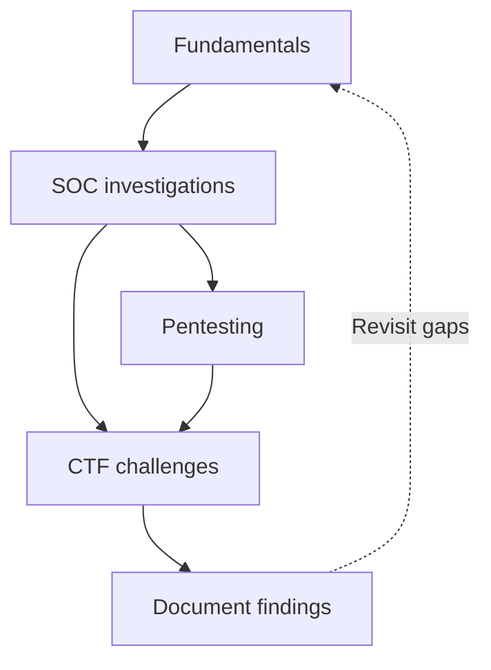

# TryHackMe journey

**Romansh Rathee · SOC analysis and penetration testing**

[TryHackMe](https://tryhackme.com/p/K4pt44n) · [GitHub](https://github.com/shilurathee) · [LinkedIn](https://www.linkedin.com/in/romansh-rathee/)

I'm documenting my cybersecurity learning, one room at a time. My focus is SOC investigations and pentesting: understanding the evidence, choosing the next step, and explaining what happened.

These notes cover concepts, commands, findings, and things worth revisiting. Older rooms may have retrospective notes instead of a record of the original attempt.

## Progress

| Capability score | Highest league | Ranking | Highest streak |
| --- | --- | --- | --- |
| 33 | Silver | Top 25% | 18 days |

*Profile snapshot: November 10, 2026. Updated manually.*

**13 rooms listed · 1 completion confirmed in this log · 1 write-up**

| Track | Listed rooms | Confirmed completed | Write-ups |
| --- | ---: | ---: | ---: |
| Fundamentals | 5 | 1 | 1 |
| SOC | 5 | Not yet confirmed | 0 |
| Pentesting | 2 | Not yet confirmed | 0 |
| CTF challenges | 1 | Not yet confirmed | 0 |

These counts describe this repository, not my total TryHackMe activity. Unconfirmed rooms may already be completed.

## Room log

| Room | Category | Difficulty | Status | Links |
| --- | --- | --- | --- | --- |
| HTTP in Detail | Fundamentals | Easy | Completed | [Room](https://tryhackme.com/room/httpindetail) · [Notes](fundamentals/http-in-detail/README.md) |
| Search Skills | Fundamentals | Easy | To confirm | — |
| Careers in Cyber | Fundamentals | Easy | To confirm | — |
| Offensive Security Intro | Fundamentals | Easy | To confirm | — |
| Defensive Security Intro | Fundamentals | Easy | To confirm | — |
| Junior Security Analyst Intro | SOC | Easy | To confirm | — |
| SOC Role in Blue Team | SOC | Easy | To confirm | — |
| SOC L1 Alert Triage | SOC | Easy | To confirm | — |
| SOC L1 Alert Reporting | SOC | Easy | To confirm | — |
| Introduction to SIEM | SOC | Easy | To confirm | — |
| Nmap Live Host Discovery | Pentesting | Medium | To confirm | — |
| Metasploit: Introduction | Pentesting | Easy | To confirm | — |
| Hidden Deep Into my Heart | CTF | Easy | To confirm | — |

Room links and write-ups are added as they are checked.

## Learning roadmap

## Repository structure

| Location | Contents |
| --- | --- |
| `README.md` | Overview and progress |
| `fundamentals/` | HTTP, networking, Linux, and Windows |
| `soc/` | Logs, SIEM, triage, and investigations |
| `pentest/` | Enumeration and authorized testing |
| `ctf-challenges/` | Challenge notes and reasoning |

Each room has its own `README.md`. Screenshots go in that room's `images/` folder when available. Category folders are created with their first write-up.

What each write-up records

- Room link, objective, difficulty, and known dates.
- Steps taken and why, where original notes are available.
- Commands or queries with explanations.
- Findings and supporting evidence.
- Problems, corrections, and topics to revisit.
- References and any hints or walkthroughs used.

Retrospective notes are labelled clearly. Illustrative examples and planned exercises are kept separate from observed results.

Publishing workflow

1. Collect notes and evidence.
2. Draft the room write-up.
3. Check technical explanations, links, and screenshots.
4. Review changes before publishing.
5. Push approved changes to `main` and update the tracker.

Room completion and documentation are tracked separately. Git history records later corrections.

## Tools I'm learning

| Tool | Focus |
| --- | --- |
| Splunk | Searching logs and investigating events |
| Nmap | Host discovery and enumeration |
| Metasploit | Exploitation concepts in labs |
| Burp Suite | Inspecting web requests and responses |
| Linux | Terminal and system fundamentals |
| Wireshark | Packet and protocol analysis |

## Sharing policy

**No flags or direct answers. Only my process and learnings.**

Screenshots and outputs are checked for credentials and personal information before publication. Room-specific sharing restrictions are respected. Testing takes place in authorized environments.
